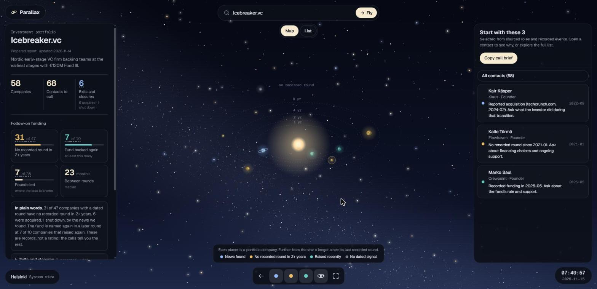

# Parallax

**Before you take a fund's money, hear from the founders who already did.**

Every VC hands you its happiest founders as references. Parallax shows you the rest of the portfolio. Name a fund and Parallax maps every recorded investment as planets around the fund's star, then gives you a sourced shortlist: which founders to call, why each one is worth calling, and what to ask them.

**[Try it live →](https://parallax-one-pi.vercel.app)** · Built in 48 hours at [Junction 2026](https://2026.hackjunction.com/), Helsinki.



## What it does

- **Map the whole portfolio.** Each planet is a portfolio company. The further it is from the star, the longer it's been since its last recorded round. Colors mark news of exits and closures, no recorded round in 2+ years, or a recent raise.
- **Get a call list.** "Start with these 3" picks founders from different companies and different experiences: an acquisition, a long gap between rounds, a fresh raise. Every reason links to its source.
- **Ask the right questions.** Each contact comes with questions written for that founder's situation, using only the facts Parallax retrieved.
- **Take it with you.** **Copy call brief** copies each person, company, contact route, questions and sources in one go.
- **See the fund at a glance.** Follow-on rate, rounds led, median time between rounds, and exits and closures, all counted from records rather than rated.

Parallax states neutral, sourced facts and never verdicts. A missing funding record is a reason to ask a question, not proof that a company failed.

## How it works

```
fund name ─▶ Cala ─▶ portfolio, rounds, lead flags, co-investors
                 └─▶ coded signals (last round, follow-on, gaps)
           ─▶ Exa  ─▶ founders (verified by work history) + news of exits, shutdowns, layoffs
           ─▶ Gemini ─▶ call questions and company overviews, only from retrieved facts
           ─▶ NDJSON stream ─▶ sky map + list view
```

- **[Cala](https://cala.ai)** is the knowledge graph. One relationship projection returns a fund's whole portfolio with sourced rounds in about half a second.
- **[Exa](https://exa.ai)** finds founders and news. Someone counts as a founder only if their work history shows a founder or CEO title at that exact company. Anyone who worked at the fund is excluded.
- **Gemini** only writes text. It never classifies or judges anything. Code drops any generated overview that contains a verdict word, or a number or name that isn't in the retrieved facts.
- Results **stream in as they arrive**. The portfolio comes first, then enrichment, starting with the companies whose last round is oldest.

## Stack

Next.js 16 · React 19 · TypeScript · Tailwind + shadcn/ui · a hand-written canvas sky engine (`components/sky/engine.ts`) · Vitest · deployed on Vercel.

## Run locally

Use Node 22: `npm ci`, then `npm run dev`, then open http://localhost:3000.

The prepared funds work without API keys. Live search needs these keys in `.env.local`:

```dotenv
CALA_API_KEY=
EXA_API_KEY=
GEMINI_API_KEY=
# Optional minimum delay between Cala requests
CALA_MIN_GAP_MS=1000
```

Checks: `npm run lint` · `npm test -- --run` · `npm run build`

## Project layout

| Path | What |
|---|---|
| `lib/pipeline.ts` | Cala records → Exa evidence → Gemini questions and overviews |
| `lib/signals.ts` | Neutral facts per company |
| `lib/call-brief.ts` | Shortlist that spreads across companies and experiences |
| `lib/rounds.ts` | Offline round enrichment: every extracted fact must come with a quote found in the source |
| `app/api/report/route.ts` | NDJSON streaming, prepared snapshots, shared live runs |
| `components/parallax-app.tsx` | Map and list views, both reading one report stream |
| `data/reports/` | Prepared fund snapshots, each showing its research date |
| `docs/` | Domain terms, design decisions, API research |

## Limits

Live runs read up to 200 portfolio links and research up to 25 companies, so a live run can take a few minutes. When coverage is partial, the app says so. Entity matching and generated text can be wrong: check the linked evidence before relying on it. Source publication dates may differ from the dates of the events they report.

---

Built with [Cala](https://cala.ai), [Exa](https://exa.ai) and Gemini at Junction 2026.
